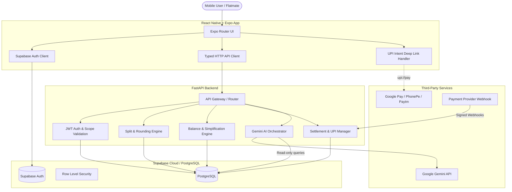

# Splitzy Architecture & Design Specification

## 1. High-Level System Architecture

Splitzy follows a client-server architecture with strict separation between deterministic financial logic, external payment flows, and generative AI features.

## 2. Financial Balance & Settlement Mechanics

### Integer Paise Invariant
Floating-point arithmetic leads to rounding errors over time (e.g., ₹100 split 3 ways is ₹33.3333...).
In Splitzy:
- All monetary amounts are recorded in **paise** (`1 INR = 100 paise`).
- Splitting ₹100 (10,000 paise) across 3 people:
  - Base share: `10000 // 3 = 3333 paise`
  - Remainder: `10000 % 3 = 1 paise`
  - Person 1 receives 3,334 paise, Person 2 receives 3,333 paise, Person 3 receives 3,333 paise.
  - Invariant checked: $\sum \text{share\_paise} = \text{amount\_paise}$.

### Net Balance Calculation
For each user $u$ within a group:
$$B_u = \sum_{e: \text{payer}(e)=u} A_e - \sum_{e: u \in \text{splits}(e)} S_{e, u} + \sum \text{SettlementsReceived}_u - \sum \text{SettlementsPaid}_u$$

Group Invariant:
$$\sum_{u \in \text{Group}} B_u = 0$$

### Debt Simplification Algorithm
Without simplification, 6 roommates could owe debts in dozens of overlapping directions.
Splitzy runs a greedy minimum cash flow reduction:
1. Calculate net balance for each member.
2. Separate into debtors ($B_u < 0$) and creditors ($B_u > 0$).
3. Match maximum debtor with maximum creditor, transferring $\min(|B_{\text{debtor}}|, B_{\text{creditor}})$.
4. Repeat until all balances reach 0. This creates the minimal number of direct transfers.

## 3. UPI Settlement Architecture

Peer-to-peer friend settlements in India rely on UPI:
1. Debtor clicks "Settle Up" on creditor's balance.
2. Backend generates a standard UPI URI:
   `upi://pay?pa={creditor_vpa}&pn={creditor_name}&am={amount_rs}&cu=INR&tn=Splitzy+Settlement+{id}`
3. Mobile app launches installed UPI client (GPay, PhonePe, BHIM, etc.).
4. Settlement is recorded with state `pending`.
5. Upon confirmation (manual confirmation from recipient or verified webhook for integrated collections), the status transitions to `completed` and updates net balances.

## 4. AI Guardrails & Isolation

Google Gemini is integrated with strict boundaries:
- **No Direct Financial Writes**: Gemini extracts structured drafts (`ExpenseDraft`) from natural language or receipts. The user must review and tap "Confirm" before any database record is created.
- **Read-Only Spending Queries**: When a user asks "Who owes me money?", the AI queries pre-authorized aggregation tools, preventing SQL injection or balance hallucination.
